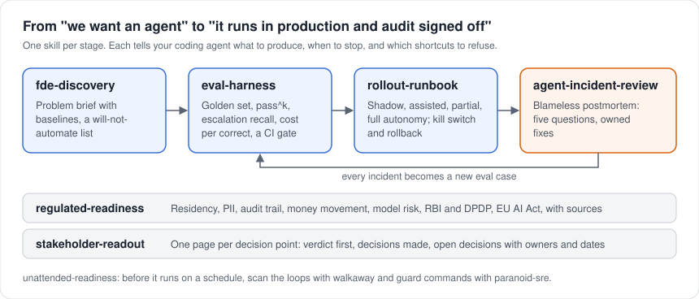

# fde-skills

**Skills for engineers who ship AI agents into companies that cannot afford them breaking.**

<p align="center"></p>

Seven agent skills that encode how a Forward Deployed Engineer takes an AI agent from "the sponsor wants one" to "it runs in production at a bank and the auditors signed off". Each skill tells your coding agent what to produce, in what template, when to stop, and which shortcuts to refuse.

Works with Claude Code, Codex, Gemini CLI, OpenCode, Cursor and any agent that reads `AGENTS.md`. No API key, no model calls: the one script, `evalkit.py`, is Python standard library.

## The skills

| Skill | Use it when | It produces |
|---|---|---|
| [fde-discovery](skills/fde-discovery/SKILL.md) | A customer says "we want an agent for X" | A one-page problem brief with baselines, a will-not-automate list, floor questions for SMEs |
| [eval-harness](skills/eval-harness/SKILL.md) | Before building, and before every change | A golden set from real cases, pass^k, escalation precision and recall, cost per correct outcome, a CI regression gate |
| [rollout-runbook](skills/rollout-runbook/SKILL.md) | The eval passed and someone asks "when do we turn it on?" | Shadow, assisted, partial and full autonomy stages with entry and exit floors, kill switch, on-call, rollback, comms |
| [agent-incident-review](skills/agent-incident-review/SKILL.md) | An agent did something it should not have | A blameless postmortem: five questions, root causes across model, context, tools and controls, owned fixes |
| [regulated-readiness](skills/regulated-readiness/SKILL.md) | Risk, compliance or audit is about to review the agent | A checklist with evidence and owners: data residency, money movement, audit trail, model risk, RBI and DPDP (India), EU AI Act, with sourced references |
| [stakeholder-readout](skills/stakeholder-readout/SKILL.md) | A sponsor needs a status or a go/no-go | A one-page readout: verdict first, decisions made, open decisions with owners and dates, named risks |
| [unattended-readiness](skills/unattended-readiness/SKILL.md) | An agent will run on a schedule or in CI | A static scan of every agent loop with [walkaway](https://github.com/shahabajsk/walkaway), fixed to L3, plus destructive-action guards from [paranoid-sre](https://github.com/shahabajsk/paranoid-sre) |

## Install

**Claude Code**

```
/plugin marketplace add shahabajsk/fde-skills
/plugin install fde-skills@fde-skills
```

Skills then run as `/fde-skills:eval-harness` and so on, or load on their own when a task matches.

**Codex, Gemini CLI, OpenCode, Cursor and others**

Clone the repo into your project or a shared folder. These agents read [AGENTS.md](AGENTS.md), which maps tasks to skills. To install single skills, copy `skills/<name>/` into the skills folder your agent uses.

```
git clone https://github.com/shahabajsk/fde-skills
```

## A worked example (fully synthetic)

A mid-size airline (invented) wants an agent to handle disruption: rebook, refund, issue care vouchers, and decide compensation when flights are cancelled.

**Discovery** finds that 70% of monthly disruption cases are same-day rebookings that follow the SOP cleanly, while unaccompanied minors, passengers reporting a medical need and groups above the agent's authority make up a small share but most of the complaints. Those go on the will-not-automate list as escalations. The decision owner is the head of airport operations. The metric: median rebooking handle time down from its baseline, with misrouted rebookings no higher than today.

**Eval harness** turns 12 representative cases into a golden set (the real thing would use 50 to 200) and runs the candidate agent 4 times on each:

```
$ python skills/eval-harness/scripts/evalkit.py \
    skills/eval-harness/examples/golden.jsonl skills/eval-harness/examples/predictions.jsonl \
    --gate --min-pass-k 0.8 --min-recall 0.95

  pass^1 (accuracy)          85.4%
  pass^4 (all 4 trials right) 50.0%
  escalation recall          83.3%
  critical-task errors       1

GATE: FAIL
  - 1 wrong outcome(s) on critical tasks: D04#3
  - pass^4 0.500 is below the floor 0.800
  - escalation recall 0.833 is below the floor 0.950
```

A single-run accuracy of 85% would have looked shippable. Across four tries, only half the cases are handled right every time, 2 of 12 escalation trials (3 cases, 4 tries each) never reached a human, both on the same case, and one trial issued travel credit where a refund to the original payment was required. Under US rules for cancelled flights that is a compliance error, which is why refund cases are marked `critical`.

**Rollout runbook** starts the agent in shadow mode on rebookings only. **Regulated readiness** flags that agent traces contain passenger data and were going to a general log store. **Stakeholder readout** goes to the head of operations: "At risk: rebooking accuracy is close to the floor, escalation recall is not. Decision needed: approve two more weeks of shadow mode, by Friday."

## What these skills will not do

- Replace legal or compliance advice. `regulated-readiness` lists its sources and the date each was checked.
- Invent numbers. Where a baseline is unknown, the skills write "unknown" and add the question to the open list.
- Grade an agent with another model by default. `evalkit.py` scores exact outcomes against human labels.

## Development

```
pip install pytest
pytest -q
```

Tests check the eval maths (including the pass^k estimator from [tau-bench](https://arxiv.org/abs/2406.12045)), every skill's frontmatter and links, and the plugin manifests.

## Author

Shahabaj Sheikh, AI Solutions Architect working forward-deployed on production agentic AI for enterprises in airlines and banking. [LinkedIn](https://www.linkedin.com/in/shahabaj)

Also by the author: [walkaway](https://github.com/shahabajsk/walkaway) (can you leave your agent loop running unattended? public from 1 December 2026) and [paranoid-sre](https://github.com/shahabajsk/paranoid-sre).

MIT licensed.
